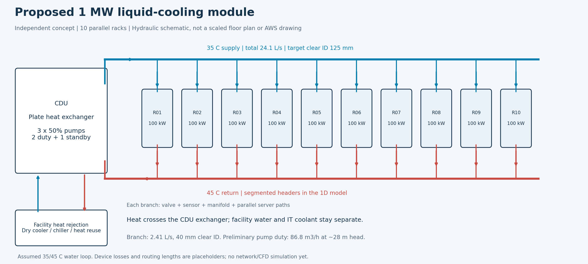

# Data-center liquid cooling: public references and first design basis

Prepared October 23, 2026. Independent Khani Solutions study. This is public-source research and illustrative presizing; no AWS/Google as-built reconstruction, construction design, or network/CFD solution is claimed.

## Recommendation

Build a modular single-phase, direct-to-chip cooling network first. Use AWS's public photographs to understand physical packaging and Google's Deschutes CDU description to understand separation of the facility-water system (FWS) and technology-cooling system (TCS). Use an independent liquid-to-liquid CDU baseline. Later compare a liquid-to-air heat-rejection variant. Modular here means a repeatable cooling block, not a claim that AWS or Google deploys a particular shipping-container layout.

The first milestone is a P&ID and dimensioned routing concept, followed by a steady 1D hydraulic balance in OpenModelica. Detailed CFD follows only for components where catalog curves or correlations cannot answer the design question.

## Public evidence and what it establishes

1. AWS, *Next-gen AI demands smarter cooling tech*: https://www.aboutamazon.com/news/aws/aws-liquid-cooling-data-centers
   - AWS describes direct-to-chip cold plates, a recirculating closed coolant loop, custom coolant distribution, and flexible deployment. The article supplies the original pump-assembly, supply/return pipe and compute-node cold-plate photographs saved under public-references/.
   - It does not provide the pipe schedule, rack flow requirement, pump curves, full P&ID, or coolant formulation needed to reproduce a deployed installation.
2. AWS sustainable infrastructure: https://aws.amazon.com/sustainability/data-centers/
   - AWS describes blended air/liquid cooling and its In-Row Heat Exchanger (IRHX). This is architecture-level evidence, not a full engineering data package.
3. Google, April 29, 2025: https://cloud.google.com/blog/topics/systems/enabling-1-mw-it-racks-and-liquid-cooling-at-ocp-emea-summit
   - Describes facility/IT-loop isolation and redundant CDU components. Its Deschutes picture explicitly compares a deployed fourth generation with a fifth-generation concept.
4. OCP Deschutes product/contribution entry: https://www.opencompute.org/marketplace/facilities-physical-infrastructure/ocp-deschutes-5-in-row-cdu/
   - Describes an OCP-accepted, Google-defined platform and provides contribution links. The v1.0 PDF URL was found, but automated download returned HTTP 403, so its detailed requirements have not been reviewed here. Do not treat specification-specific temperatures, flow rates or pressure limits as verified.
   - Specification link: https://www.opencompute.org/documents/ocp-specification-deschutes-v1-0-pdf
5. Google Brazos, June 16, 2026: https://cloud.google.com/blog/topics/systems/brazos-liquid-cooling-system-for-air-cooled-data-centers
   - A different, documented liquid-to-air rack/sidecar approach: three modular units, 60 kW nominal per rack, heat rejected to the hot aisle. The facility must still remove that heat. This is a useful alternative topology, not our 1 MW baseline or evidence of AWS's exact implementation.
6. Public Vertiv XDU1350 operation manual: https://www.vertiv.com/4a865d/globalassets/products/thermal-management/high-density-solutions/liebert-xdu-coolant-distribution-units/70619-xdu1350-operation-and-maintenance-manual-rev-b_07-22-final-locked.pdf
   - Reviewed PDF pages 17-20 and 73 (printed pages 13-16 and 69): assembly views/component keys and pipe schematic. Shows pumps, heat exchangers, expansion vessels, filtration, fill equipment, vents, relief protection, instrumentation and control valves. This is an architectural reference; the current product-family page labels the family discontinued. No current purchasing availability or fit to our duty is established.
7. Amazon patent US10201116B1: https://patents.google.com/patent/US10201116B1/en
   - Amazon Technologies Inc, published February 5, 2019; older rack air-to-fluid heat-exchanger arrangements. A patent is background design evidence, not proof of an installed system or the current direct-to-chip IRHX design.
8. AWS CFD role: https://www.amazon.jobs/en/jobs/10437257/sr-mechanical-engineer-cfd-global-engineering-strategy
   - Explicitly identifies site/building CFD, cooling-system selection and water-use analysis as AWS infrastructure engineering tasks. Distinguish this from customers merely running CFD on AWS.
9. Open-source Modelica reference: https://simulationresearch.lbl.gov/modelica/releases/v12.1.0/help/Buildings_Applications_DataCenters.html
   - The Buildings library's documented DataCenters examples use air-cooled computers with chilled-water or DX cooling. Facility-plant/control models are useful references; these are not ready-made direct-to-chip rack models.
10. OCP cold-plate guidance: https://www.opencompute.org/projects/cooling-environments/cold-plate/
    - Source for the interface, coolant and connector standards we must check when selecting actual IT equipment. A requirements PDF link was found but not fully retrieved/reviewed in this session.
11. Pump selection/NPSH reference: https://www.grundfos.com/solutions/learn/ecademy/all-courses/the-basic-pump-curve-course/how-to-read-a-pump-curve-

Original photos retain their owners' attribution. Study copies are retained for reference; public availability does not grant unrestricted republication rights.

## Independent initial assumptions

| Item | First design assumption |
|---|---|
| Heat transferred to liquid | 1 MW, ten racks at 100 kW liquid load each |
| Residual air cooling | Separate load, not included in the 1 MW calculation |
| Coolant calculation | Water properties near 40 C: rho 992.2 kg/m3, cp 4179 J/kg/K, mu 0.653 mPa s |
| TCS temperatures | 35 C supply, 45 C return; subject to actual cold-plate limits and dew point |
| Initial FWS test boundary | 25 C supply / approximately 35 C return, not an assumed site capability |
| Header pair | 40 m total straight length, aggregate K=6 |
| One rack branch pair | 20 m total straight length, aggregate pipe/fitting K=8 |
| Pipe roughness | 15 micrometres, assumed |
| Static elevation | Parametric 0-5 m, with a pressurized, filled closed loop |
| Pump redundancy concept | Three 50% pumps, two duty plus one standby |

Coolant chemistry is not specified by the water-property assumption. Actual inhibited water/glycol, wetted metals, seals, water quality and temperature-dependent properties must follow the selected equipment's compatibility limits. Do not assume pure DI water remains suitable after circulation. Outdoor freeze protection is a separate FWS decision.

## Proposed assembly and physical arrangement

TCS: CDU heat exchanger -> variable-speed pump bank -> filtered supply header -> ten parallel, isolatable rack branches -> rack supply manifold -> parallel server/cold-plate circuits -> rack return manifold -> return header -> CDU heat exchanger.

The expansion/pressurization connection should reference an appropriate low-pressure point near pump suction. Provide vents at high points, low-point drains, fill/flush connections, relief protection, leak detection, isolation and check valves per the selected arrangement. Filter location and bypass/redundancy must preserve pump inlet pressure and serviceability. Do not put an uncharacterized restrictive strainer immediately upstream of a pump.

FWS: heat-rejection plant -> primary supply -> CDU exchanger -> primary return -> heat-rejection plant. The fluids do not mix. Site climate, water availability and approach temperatures determine dry-cooler, economizer, chiller, cooling-tower or heat-reuse selection. Liquid-to-air is a distinct alternative in which the room air system still removes the released heat.

For a physical concept, reserve a roughly 20 x 8 m planning envelope for ten racks, aisle/service access and a CDU service zone; this is an arbitrary layout study, not an approved clearance standard. Place headers where leaks can be detected/contained and maintenance is possible; avoid routes above exposed energized equipment where practical. Compare overhead and perimeter routes. A dimensioned CAD route must determine each actual straight length, bend radius, fitting, high point, support and flexible service connection. The current 40/20 m lengths are only presizing placeholders.

Compare direct return with reverse return. Reverse return can reduce path-length imbalance but does not eliminate balancing, different cold-plate resistance or elevation-pressure checks. Minimize unnecessary restrictions and sharp bends; use standard long-radius elbows where space permits, evaluated with the actual manufacturer's data. Allow installation tolerances, thermal expansion, pipe supports, strain relief, hose minimum bend radius and equipment removal space.

## Flow and pipe sizing

Use mass flow = heat/(cp * coolant rise), volume flow = mass flow/rho.

- 1 MW / (4179 J/kg/K * 10 K) = 23.93 kg/s = 24.12 L/s = 86.82 m3/h.
- Each 100 kW liquid-cooled rack needs 2.412 L/s, or 144.7 L/min.
- A 5 K rise doubles module flow to 48.23 L/s. A 15 K rise reduces it to 16.08 L/s, but may increase chip temperatures.
- Actual per-server flow depends on server count, thermal resistance and vendor requirements; divide among parallel paths, not among chips without checking their topology.

Use Darcy-Weisbach: dp = [f*L/D + sum(K)] * rho*v^2/2. Here f is the Darcy factor, calculated with Haaland in turbulent flow. Confirm Reynolds regime and use the correct correlation. K uses a defined reference diameter/velocity and may depend on Reynolds number, valve position and tee flow split.

| Service | Hydraulic clear ID | Velocity | Assumed straight + fitting loss |
|---|---:|---:|---:|
| Header pair, full flow over all 40 m | 100 mm | 3.07 m/s | 56.0 kPa |
| Same | 125 mm | 1.97 m/s | 20.7 kPa |
| Same | 150 mm | 1.36 m/s | 9.3 kPa |
| One rack branch pair, 20 m | 32 mm | 3.00 m/s | 88.8 kPa |
| Same | 40 mm | 1.92 m/s | 32.1 kPa |
| Same | 50 mm | 1.23 m/s | 11.8 kPa |

Start the comparison at 125 mm header clear ID and 40 mm rack-branch clear ID, and retain 150/50 mm as the lower-loss alternative. These are internal diameters, not a guaranteed DN/NPS/schedule selection. Match real pipe wall thickness, fittings and ports before procurement. Compare installed cost, space and pump energy rather than treating a velocity target as a universal code limit.

Full-flow treatment over the entire header is deliberately conservative. A segmented network will reduce supply flow after each takeoff and increase return flow after each connection. Fit losses on the selected critical circuit must be evaluated segment by segment; do not add the losses of ten parallel racks together.

## Provisional pressure budget and pump concept

| Critical-circuit item | dp |
|---|---:|
| Header pair, 125 mm ID | 20.7 kPa |
| One rack pipe/fitting pair, 40 mm ID | 32.1 kPa |
| One rack's internal cold-plate/hose/QD path | 100 kPa assumed |
| CDU exchanger secondary side | 45 kPa assumed |
| Filter at dirty design condition | 20 kPa assumed |
| Branch control valve | 15 kPa assumed |
| Total before margin | 232.8 kPa |
| With 15% provisional pressure margin | 267.7 kPa |

Target approximately 86.8 m3/h at 27.5 m coolant head (about 270 kPa). At an assumed 65% wire-to-water efficiency, total pump electric input is approximately 9.93 kW. Heat rejection must include pump heat and any other heat entering the coolant, not just chip heat.

In a three-pump, two-duty concept, each duty pump supplies approximately 43.4 m3/h at the same 27.5 m head. Head does not divide by two. Parallel pump curves must be combined; loss of one pump changes the operating point until standby starts. Final selection requires certified head-flow, efficiency, power and NPSHR curves across speed, coolant and temperature, including minimum stable flow and shutoff head. A pump brand or CDU headline MW rating alone is insufficient.

These device drops are placeholders, not vendor specifications. Obtain cold-plate and rack curves, QD pairs, hoses, control-valve Kv/Cv versus position, clean/dirty filter curves, CDU heat-exchanger curves and internal CDU losses. Do not double-count an included CDU loss when a supplier gives external available differential pressure.

Thermal selection is independent of pump head: verify exchanger UA and terminal approaches. For illustrative FWS 25/35 C and TCS 35/45 C, both counterflow terminal differences are 10 K, so 1 MW implies UA approximately 100 kW/K before fouling/pump heat. A dry cooler cannot supply 25 C water in 35 C ambient air; climate may require a warmer loop or mechanical cooling.

## Elevation, pressure ratings and suction conditions

In a completely filled closed loop, upward and downward hydrostatic contributions cancel around the circuit for equal density. Buoyancy from temperature-dependent density can remain, but one does not simply add the rack/header height to circulating pump head.

Elevation still changes local pressure. A 5 m elevation difference corresponds to about 48.7 kPa for this water assumption. Set cold-fill/expansion pressure to retain adequate pressure at the highest point and check maximum pressure at the lowest point. Include pump shutoff head, thermal expansion and transients when setting component pressure ratings. Distinguish pump differential pressure from system gauge/absolute pressure.

Check available NPSH using absolute pump inlet pressure, local velocity, vapor pressure at the hottest condition and suction losses; compare with NPSHR plus an appropriate application margin. Check failed-pump operation, dirty filters and low fill pressure. If an open reservoir/free-surface transfer is introduced, net elevation between free surfaces DOES add static head. Expansion-vessel capacity requires actual system inventory, coolant expansion, precharge and operating-pressure range; it is not sized from heat load alone.

## Where 1D correlations work and where CFD adds value

| Component/question | Initial method | CFD trigger |
|---|---|---|
| Straight circular pipe | Darcy friction with fluid properties | Nonstandard cross-section or local separation matters |
| Standard long-radius elbow | Catalog/test K or fitting correlation | Very compact bends, interacting elbows or inlet distortion |
| Tee | Split-dependent run/branch correlations | Custom header geometry or uncertain maldistribution |
| Valve and QD | Manufacturer curves, valve position and local bore | Custom passage or no adequate curve; cavitation/local loading question |
| Heat exchanger | Vendor dp/flow and UA/approach maps | Designing the exchanger or its distributor, not merely selecting it |
| Cold plate | OEM thermal/hydraulic maps | Designing channels, conjugate heat transfer or chip hotspot uniformity |
| Pump | Speed-dependent pump/efficiency/NPSHR maps | Internal pump design or unusual suction geometry |
| Air side | Fan/coil maps and room energy balance | Rack recirculation, containment leakage, fan-coil placement, outdoor hot-air reingestion |

Likely high-loss candidates are the narrowest QDs/ports, cold-plate channels, small hoses, partially closed control valves, dirty filters, exchanger passages and abrupt manifold transitions. Their actual ranking must come from measured/vendor curves and the solved critical circuit. A standard elbow need not be the dominant loss. High manifold maldistribution can matter thermally even when total manifold dp is modest.

For selected 3D components, export dp(flow, split, temperature) and thermal maps back into OpenModelica. Compare mass balance, total-pressure loss, thermal energy balance and branch-flow distribution; run mesh/near-wall and boundary-condition sensitivity. Do not substitute a visually smooth contour for validation. Detailed cold-plate flow may require a different flow-regime treatment from a turbulent main header.

## Component selection specification

- CDU: independent liquid-to-liquid design or a current Deschutes-compatible platform candidate; select by thermal duty at real approaches, available external differential pressure, fluid compatibility, redundancy, electrical supply, service access and controls. Deschutes platform listing is not a completed product selection.
- Pumps: variable-speed centrifugal pump bank, compatible wetted materials, isolation/check valves and appropriate power backup. Final manufacturer/model follows curve matching.
- Headers: compatible stainless tubing/pipe, accessible supports, service isolation, high-point air management and low-point drains.
- Rack branches: isolation, flow measurement, balancing or pressure-independent control where appropriate, temperature sensing, appropriately rated flexible hoses and dry-break connectors.
- Instrumentation: suction/discharge absolute or gauge pressure as needed, differential pressure across critical branch/filter, per-rack flow, supply/return temperature and dew point, leak and fill-level signals.
- Protection/service: relief, expansion/pressurization, controlled fill/flush/drain, water chemistry/filtration and removable components. Protect minimum pump flow; avoid uncontrolled bypasses that waste cooling capacity.

## OpenModelica build and validation sequence

1. Freeze a design-basis sheet and draw a tagged P&ID: pump P-101 A/B/C, HX-101, supply/return H-101/H-102 and racks R-01...R-10. Use explicit port orientation, units, elevations, coolant and start conditions.
2. Build a simple steady hydraulic network with segmented headers, one equivalent resistance per rack, actual pump curves and a pressure reference. Check branch-flow and pressure budgets before adding controls.
3. Resolve rack manifolds and server branches. Compare equal/unequal loads, path lengths, diameters and valve settings; distinguish parallel from series components.
4. Add finite thermal volumes, temperature-dependent coolant properties, heat loads, exchanger UA/maps, facility boundary conditions and residual air load. Close the energy balance.
5. Add VFD differential-pressure control, temperature control at the CDU, valve dynamics and sensor/actuator delay. Reset pressure to the critical branch when justified. Do not control solely from a near-CDU pressure sensor and assume far racks are served.
6. Test 25/50/75/100% load, rack load steps, hot FWS, uneven branches, dirty filter, partial blockage, failed pump/standby start, low fill pressure and service isolation. Evaluate closure and pump coastdown; a simple incompressible model does not establish water-hammer peak pressure.
7. Use FreeCAD for the reviewable physical routing/assemblies. Use OpenFOAM on Intel for a custom distribution manifold first; add cold-plate or room-air CFD only when needed. Feed component maps into the 1D model.
8. Validate with pump/valve/QD/HX test curves and eventually a physical loop: calibrated flow/pressure/temperature, instrument uncertainty, leak/flush procedures, steady balance and load transients. Separate calibration cases from holdout tests.

## Reproducibility and current status

`concept_sizing.py` generates `concept-sizing.json` and `pipe-candidates.csv`. `draw_concept.py` generates the conceptual diagram on Intel. Sources and original pictures are under `public-references/`.

Completed: OpenModelica installation and stock hydraulic software test; public-source review, initial assumptions, independent presizing and conceptual schematic. Not completed: dimensioned CAD/P&ID, device selection, OpenModelica data-center network, component CFD, construction engineering or physical validation.
